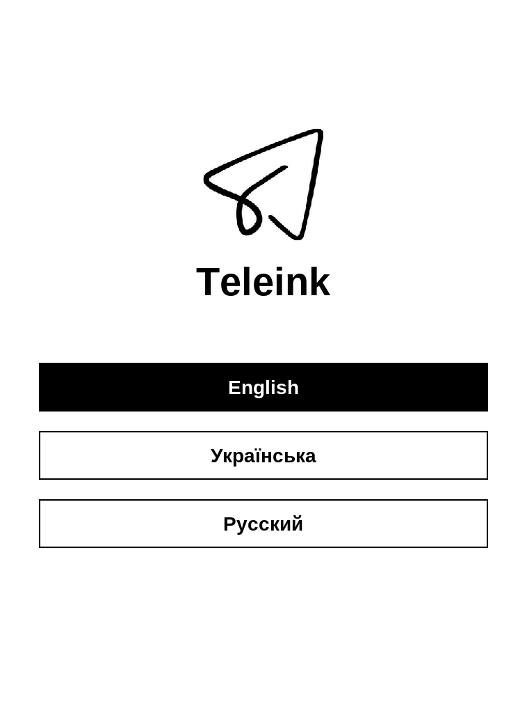
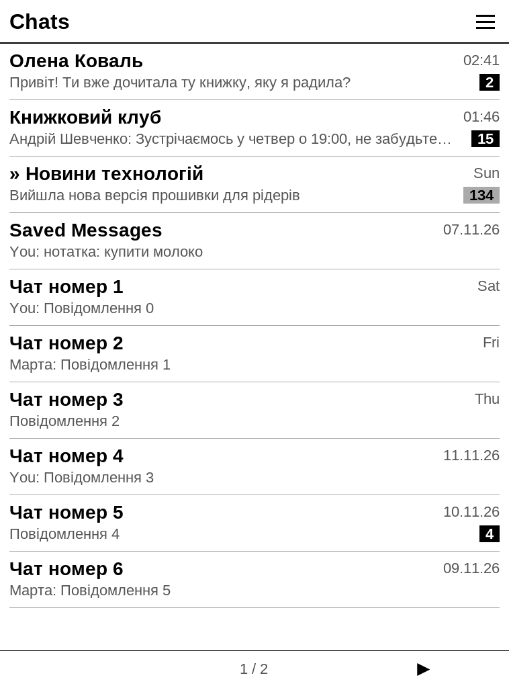
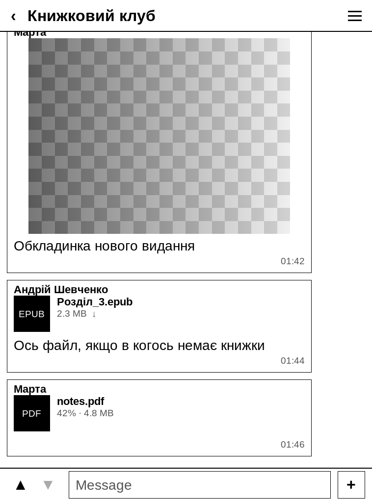
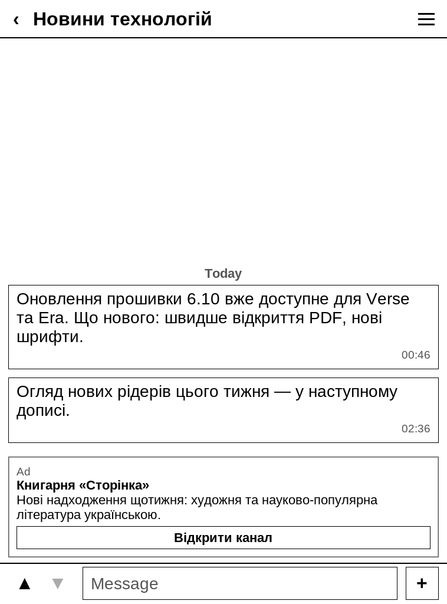

# Teleink

Unofficial Telegram client for PocketBook e-readers (firmware 6.x).
Uses the Telegram API via [TDLib](https://github.com/tdlib/td). Not affiliated with Telegram.

| | | | |
|---|---|---|---|
|  |  |  |  |

## Install

1. Download the zip from [Releases](../../releases).
2. Copy its contents to the root of the reader (`Teleink.app` → `applications/`).
3. Open **Teleink** in Applications.

No built-in API keys? Get `api_id` and `api_hash` at [my.telegram.org](https://my.telegram.org) → API development tools.

## Features

Chats only, nothing else: read and write, files (download to `Downloads/Teleink`, books and photos open in the reader, send from the reader) · English, Українська, Русский.

## Build

```sh
scripts/setup.sh   # SDK, Zig, OpenSSL, TDLib → ./deps (≈1 h first time)
scripts/build.sh   # → out/Teleink.app, out/Teleink-dev.zip
```

Embed keys: `TG_API_ID=… TG_API_HASH=… scripts/build.sh`, or add `TG_API_ID` / `TG_API_HASH` as repository secrets — GitHub Actions then builds every published release with them.

## License

[MIT](LICENSE) · [third-party notices](THIRD_PARTY_NOTICES.md) · Telegram is a trademark of Telegram FZ-LLC.

---

**Українська.** Неофіційний клієнт Telegram для PocketBook. Скопіюйте вміст архіву з [Releases](../../releases) у корінь рідера й відкрийте **Teleink**. Мову обирають під час першого запуску.

**Русский.** Неофициальный клиент Telegram для PocketBook. Скопируйте содержимое архива из [Releases](../../releases) в корень ридера и откройте **Teleink**. Язык выбирается при первом запуске.
